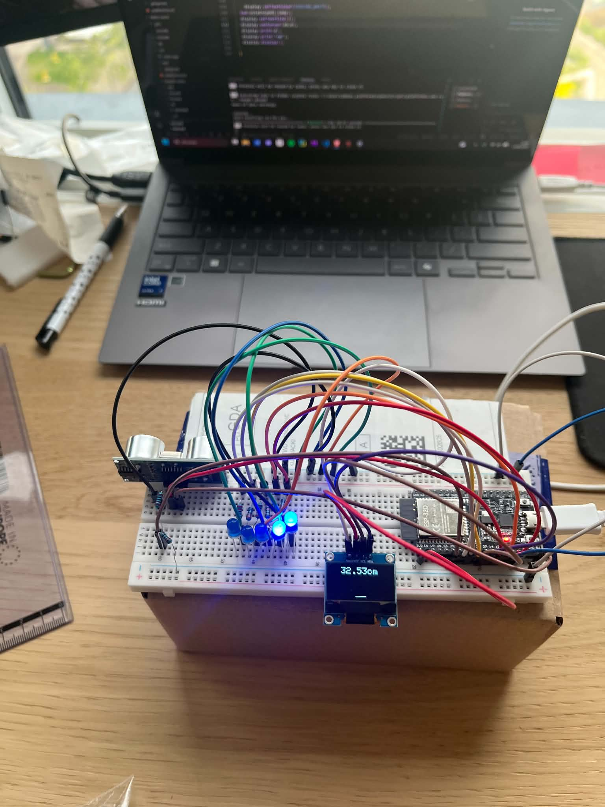

# Czujnik parkowania – ESP32 + HC-SR04 + OLED + LED




https://github.com/user-attachments/assets/3df1ce6f-af3b-4e4e-baed-234bc4f98d24


Ultradźwiękowy czujnik odległości na **ESP32 (NodeMCU-32S)**, działający jak czujnik parkowania w samochodzie:
- **OLED SSD1306** pokazuje odległość w centymetrach i animację klepsydry,
- **pasek 5 diod LED** zapala się tym bardziej, im bliżej jest przeszkoda,
- pomiary są też wysyłane na **Serial Monitor**.

Projekt w **PlatformIO** (framework Arduino).

---

## Działanie

1. ESP32 wysyła impuls **10 µs** na pin TRIG czujnika.
2. Czujnik wysyła falę ultradźwiękową i ustawia stan wysoki na ECHO na czas jej powrotu.
3. Odległość liczona jest ze wzoru:

   ```
   d [cm] = t [µs] · 0,0343 / 2
   ```
   gdzie 0,0343 cm/µs to prędkość dźwięku (343 m/s w ok. 20 °C), a dzielenie przez 2 wynika z tego, że fala pokonuje drogę tam i z powrotem.

4. Do sterowania diodami wynik jest **wygładzany filtrem wykładniczym (EMA)**, żeby diody nie migały:

   ```
   d_filtr = 0,6 · d_filtr_poprzednie + 0,4 · d_pomiar
   ```

   Na wyświetlaczu i w Serial Monitorze widać **surowy pomiar**.

### Pasek LED

| Odległość (po filtrze) | Zapalone diody |
|---|---|
| poniżej 10 cm | 5 |
| 10–20 cm | 4 |
| 20–30 cm | 3 |
| 30–40 cm | 2 |
| 40–60 cm | 1 |
| powyżej 60 cm | 0 |

---

## Podzespoły

| Element | Model | Ilość |
|---|---|---|
| Mikrokontroler | ESP32 NodeMCU-32S | 1 |
| Czujnik odległości | HC-SR04 (ultradźwiękowy) | 1 |
| Wyświetlacz | OLED SSD1306 128 × 64, I2C (adres `0x3C`) | 1 |
| Diody LED | dowolne 3/5 mm | 5 |
| Rezystory do LED | 220–330 Ω | 5 |
| Rezystory do dzielnika napięcia ECHO | 1 kΩ + 2 kΩ | 1 + 1 |
| Płytka stykowa + przewody | – | – |

---

### Czujnik HC-SR04
| HC-SR04 | ESP32 | Uwagi |
|---|---|---|
| VCC | 5V (VIN) | |
| GND | GND | |
| TRIG | GPIO14 | |
| ECHO | GPIO35 | przez dzielnik napięcia (patrz niżej) |

> ⚠️ HC-SR04 zasilany z 5 V daje na ECHO **5 V**, a piny ESP32 przyjmują maksymalnie **3,3 V**. Między ECHO a GPIO35 daj dzielnik: **ECHO → 1 kΩ → GPIO35 → 2 kΩ → GND**. Na pinie będzie ok. 3,3 V.
>
> GPIO35 to pin **tylko wejściowy**, więc dobrze nadaje się na ECHO.

### Wyświetlacz OLED (I2C na niestandardowych pinach)
| OLED | ESP32 |
|---|---|
| VCC | 3V3 |
| GND | GND |
| SDA | GPIO27 |
| SCL | GPIO26 |

Piny I2C są ustawione w kodzie: `Wire.begin(27, 26);` (SDA, SCL).

### Diody LED
Każda dioda: **GPIO → rezystor 220–330 Ω → anoda LED (dłuższa nóżka) → katoda → GND**.

| Dioda | ESP32 |
|---|---|
| LED 1 | GPIO13 |
| LED 2 | GPIO12 |
| LED 3 | GPIO25 |
| LED 4 | GPIO33 |
| LED 5 | GPIO32 |

---

### Biblioteki
- Adafruit SSD1306
- Adafruit GFX Library
- Adafruit BusIO

---

## Struktura projektu

```
├── src/
│   └── main.cpp        ← pomiar, filtr, obsługa OLED i LED
├── include/
├── lib/
├── test/
├── docs/               ← schemat i zdjęcia
└── platformio.ini      ← konfiguracja płytki (nodemcu-32s) i bibliotek
```

---

## Autor
**kminek22** – student Automatyki i Robotyki, Politechnika Gdańska.
